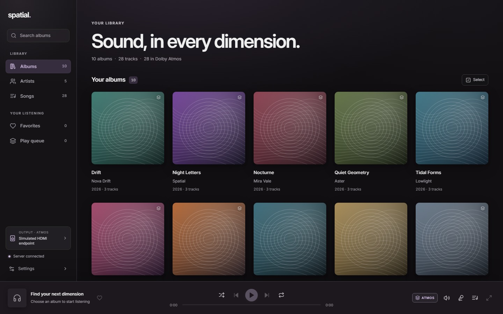
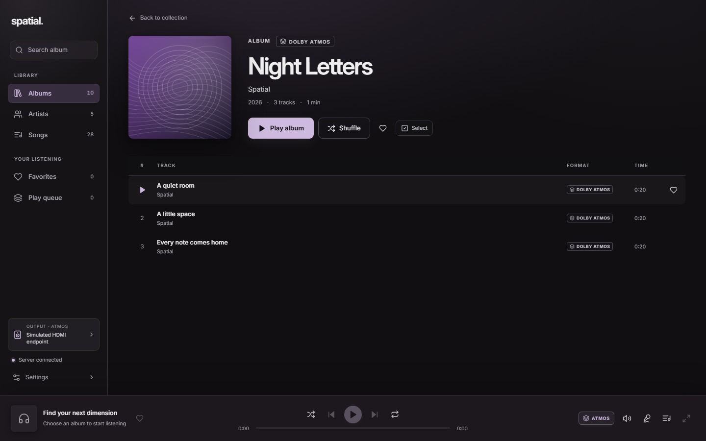
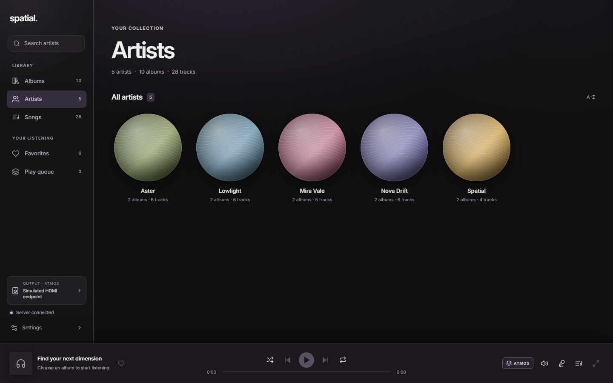
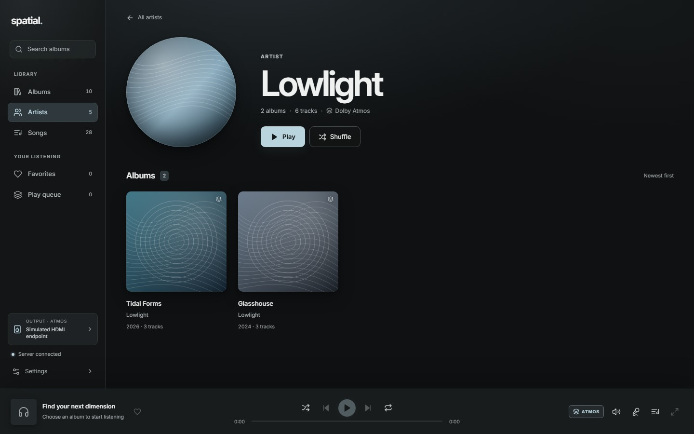
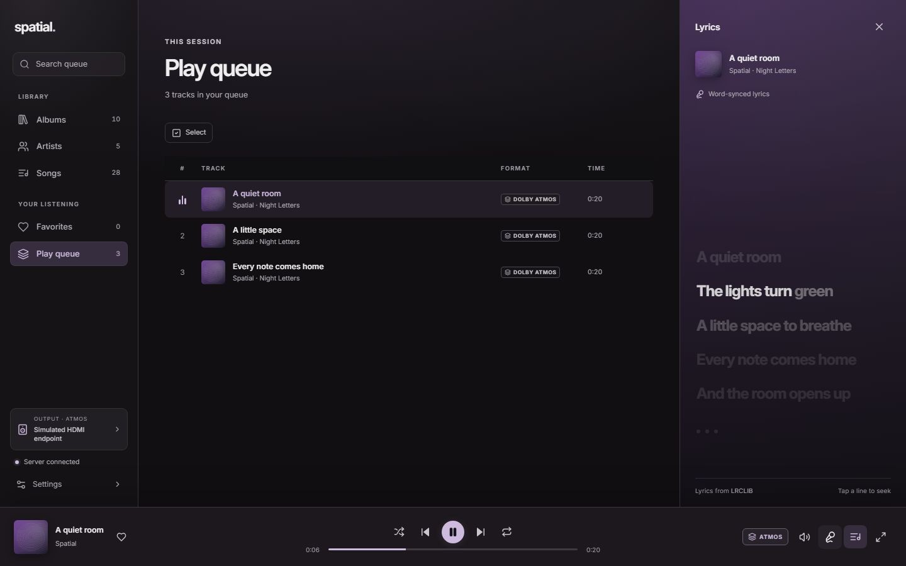
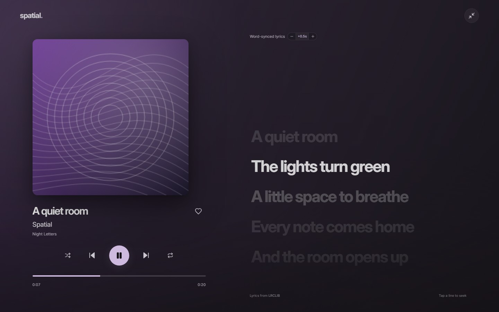
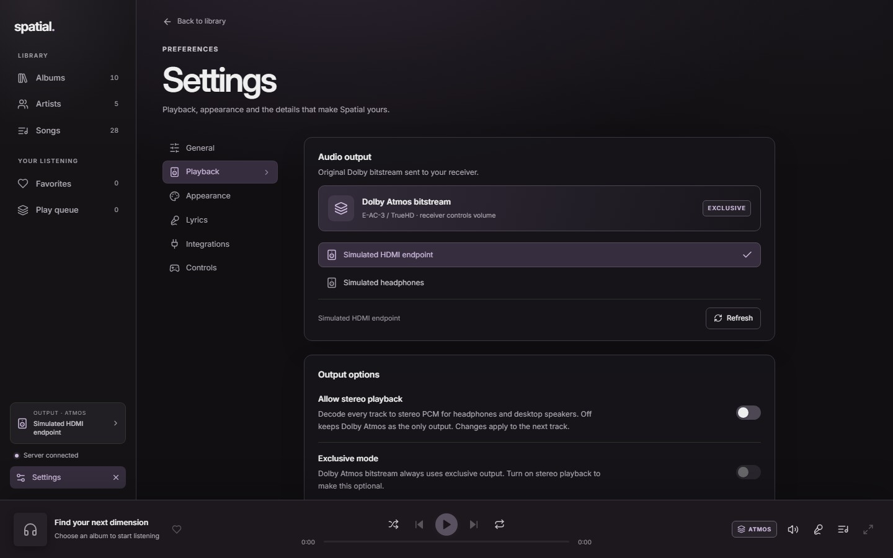
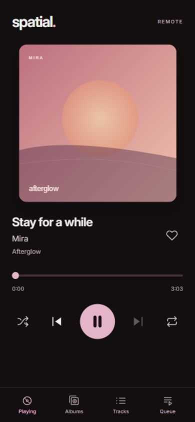

# Spatial

### Dolby Atmos music streaming, with a player built around the music.

Spatial connects a music library on a server to a native desktop player. Browse albums and artists, follow synced lyrics, and send the original Dolby audio bitstream over HDMI to an Atmos-capable receiver — or decode to stereo on headphones.

The server discovers albums from file metadata and keeps connected clients up to date. Place music in the configured media directory; Spatial handles the catalog, artwork and streaming.



**[Get started](#get-started)** · **[Screenshots](#a-closer-look)** · **[Playback](#playback)**

## New in 0.1.17

- **Artist pages with portraits.** Every credited artist gets a Deezer portrait, cached on the server, and a page with their full discography.
- **A tabbed Settings page.** Playback, appearance, lyrics, integrations and controls now live on one page instead of a dialog.
- **Stereo playback for headphones.** Decode any supported track to stereo PCM, with optional exclusive mode and software volume, while keeping the original Dolby bitstream path for a receiver.
- **Apple Music-inspired lyrics.** A brighter active line, artwork-colored backdrop and smoother word highlighting in the side panel and fullscreen player.
- **A cleaner shell.** Search moved into the sidebar, refreshed album and artist browsing, and a new player bar.

See the [settings guide](docs/settings.md) for the new controls.

## What you can do

- **Stream original Dolby audio.** E-AC-3 and TrueHD passthrough through the desktop's HDMI output, with source files served without transcoding.
- **Browse a live library.** Albums, artists, artwork and track order come from embedded tags. Filesystem changes reach connected clients automatically.
- **Start with an artist.** Every artist in the collection gets a portrait and a page with their full discography, including albums they appear on. Portraits come from Deezer and fall back to album art when no match exists.
- **Listen your way.** Keep the original Dolby Atmos bitstream for a receiver, or turn on **Allow stereo playback** in Settings → Playback to decode any supported track to stereo PCM for headphones. Exclusive mode and software volume are configurable.
- **Listen from your controller.** [Gamepad controls](docs/controller.md) cover navigation, play/pause, seeking and fullscreen, with configurable button mappings in Settings.
- **Make it yours.** Save favorite albums and tracks locally, manage selections in bulk, and copy a favorites list to share with another Spatial listener. A full [Settings](docs/settings.md) page holds playback, appearance, lyrics, integration and controller preferences.
- **Follow the words.** [Synced lyrics](docs/lyrics.md) use a bright line-at-a-time treatment inspired by Apple Music, artwork-colored backgrounds and word-by-word highlights in the resizable side panel and fullscreen player. Click a line to seek, or keep browsing while the song continues.
- **Fill the screen with the music.** Open the [fullscreen player](docs/fullscreen.md) for large album artwork, playback controls, and animated lyrics against a moving album-colored background.
- **Keep listening.** Build a playback queue, move between tracks, and reopen the app with the server connection remembered securely.
- **Stay in your listening spot.** Enable the [phone remote](docs/remote.md), scan a QR code, and browse your collection or control the desktop player from a phone on the same network.
- **Share your listening.** [Discord activity](docs/discord.md) shows the current track, public album artwork and playback progress. Enabled by default, with a saved opt-out.
- **See the album in the interface.** Artwork sets the palette, with smooth color changes, transitions and support for reduced motion.

## A closer look

### Albums and tracks

Artwork, release information and the track list stay together in the album view.



### Artists

Every credited artist gets a portrait and a page with their albums. Open any artist from the grid, an album's artist line, or search.



### Artist pages

Portraits, album counts and the complete discography, including albums the artist appears on, with Play and Shuffle for the whole artist.



### Queue and synced lyrics

The queue lives in the main view. Lyrics sit beside it, with adjustable width and a highlight that follows playback.



### Fullscreen listening

Album artwork and controls sit beside large synced lyrics. The current line glides into focus, with colors and ambient motion drawn from the album cover.



### Settings

Output, stereo and exclusive playback, artwork, motion, lyrics, Discord, the phone remote and controller mappings live together in one tabbed page.



### A remote from your listening spot

Scan a QR code in desktop Settings to open a phone remote. Browse albums, search, change tracks and control the same playback queue, with colors that follow the album.



*Screenshots show the current interface with original demo artwork, fictional releases and simulated playback.*

## Get started

Spatial has two parts: a server that reads the music files and a desktop app that plays them. They can run on separate machines or on the same computer.

| Component | Current requirements |
| --- | --- |
| Server | Rust service with FFmpeg/FFprobe; native Linux setup scripts are provided. MediaInfo improves Atmos metadata detection. |
| Desktop | Windows x64 with WebView2, or Linux x64 with mpv and a desktop keyring. An HDMI endpoint connected to an Atmos receiver is required for Dolby bitstream; headphones work with stereo playback. |

1. **Start the server.** Follow the [server setup guide](docs/server.md), choose a media directory, and create an access token. Configuration, the catalog and artwork cache can stay in the project directory.
2. **Install the desktop app.** Download a Windows installer, Linux AppImage or Debian package from [GitHub Releases](https://github.com/im-tesla/Spatial/releases/latest). See the [Linux guide](docs/linux.md) for requirements, or the [development guide](docs/development.md#build-the-desktop-app) to build from source.
3. **Connect and play.** Enter the server's reachable HTTP or HTTPS address and its access token. Choose the receiver's HDMI endpoint in **Settings → Playback**, then play an album. For headphones, select your output and turn on **Allow stereo playback** there.

The app remembers a successful connection securely in Windows Credential Manager or the Linux desktop keyring and reconnects on launch. The server address is configurable; use the address that reaches your deployment.

For control from your phone, open **Settings → Integrations → Phone remote**, enable it, and scan the QR code. The desktop continues using the output selected in Settings → Playback; the phone controls its existing player and queue.

Windows and Linux AppImage clients automatically check for new releases and offer **Update and restart** when a signed update is available. Debian installations update by installing the newer package. See [desktop updates](docs/updates.md) for the release workflow.

Spatial runs natively. Docker is not required.

## Playback

```text
Music files → Spatial server → Desktop player → HDMI bitstream → AVR
                                             └→ Stereo PCM → Headphones
```

The server streams original file bytes. In the default mode, the native player demuxes the audio and requests compressed Dolby output through WASAPI exclusive mode on Windows or direct ALSA HDMI output on Linux, preserving the encoded Atmos information for the receiver to decode. With **Allow stereo playback**, mpv decodes the selected track to stereo PCM and can use shared or exclusive output. Linux support is new; physical AVR verification has so far been performed on Windows.

This is an early preview. By default playback supports the compressed E-AC-3 and TrueHD bitstream path. Turn on **Allow stereo playback** in Settings → Playback to decode E-AC-3, TrueHD, AAC, FLAC, MP3 and other mpv-supported tracks to stereo PCM on headphones or desktop speakers; exclusive mode can be disabled for shared output, and software volume is available in that mode. Dolby bitstreaming sends the original frames and leaves volume to the receiver. Dolby MAT is outside the current playback path.

## Library and privacy

Albums are grouped by metadata rather than folder names. Consistent album, album-artist, date and release tags produce the best results. Embedded artwork is preferred, with adjacent cover images as a fallback.

Favorites, panel width and output preferences stay on the client. Lyrics first use a matching `.ttml` file beside the audio on the server, including word timing when supplied, and the credit reads **Local lyrics**. If local lyrics are missing or unreadable, Spatial falls back to [LRCLIB](https://lrclib.net/), with no account or API key. Only fallback lookups send the track's title, artist, album and duration to that provider; audio and server credentials are never sent. Cached service lyrics remain available offline; coverage depends on the recording. See the [lyrics guide](docs/lyrics.md) for sidecar naming and timing formats.

Missing album covers can be filled from Apple/iTunes and MusicBrainz Cover Art Archive; missing artist portraits are resolved from Deezer and cached on the server. Both features send only the album or artist name to those providers. Set `remote_artwork = false` for an offline library.

In Favorites, **Copy favorites** creates a portable list that another client can paste into **Import favorites**. Matching albums and tracks already in that client's library are saved locally. Use **Select** to add or remove favorites in bulk, or copy just a selection. See the [favorites guide](docs/favorites.md) for details.

## For contributors

The server uses **Rust, Axum and SQLite**. The desktop uses **Tauri, React, TypeScript and Motion**, with a native mpv playback process.

See [development and testing](docs/development.md) for the repository layout, local preview, build commands and passthrough checks. Persistent playlists, library editing, multi-user accounts and automatic server discovery are planned work. Settings, artists and stereo playback are documented in the [feature guide](docs/settings.md).

## License

Spatial's code is released under the [MIT License](LICENSE). The desktop includes [Inter](https://rsms.me/inter/) under its [SIL Open Font License](apps/desktop/public/fonts/OFL.txt). Bundled mpv and its dependencies retain their own licenses; see [binary distribution](docs/development.md#binary-distribution) before publishing installers.
