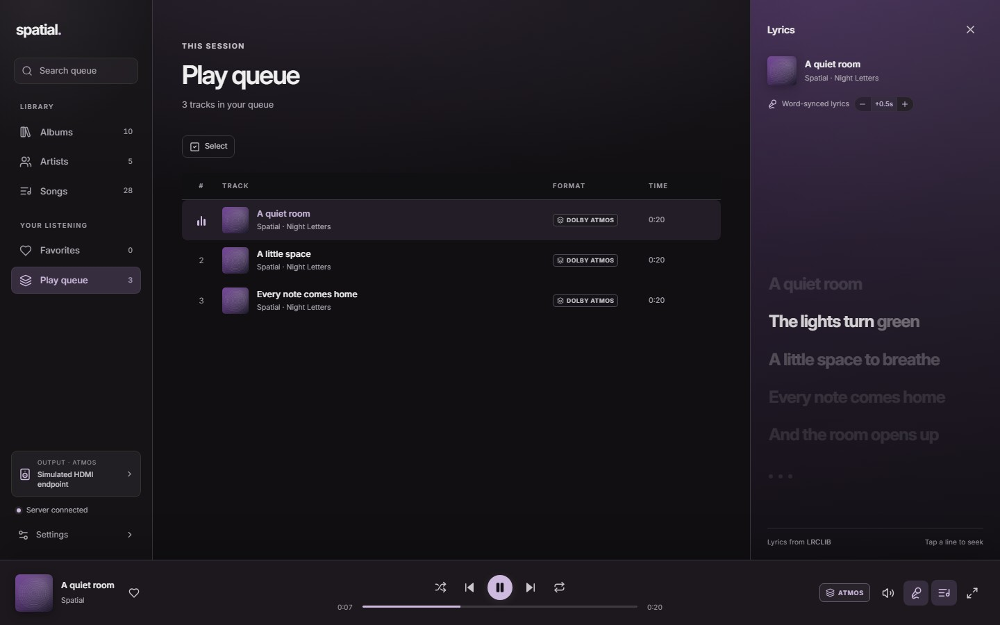

# Lyrics



Open lyrics with the microphone icon on the player bar, or enter the fullscreen player. Both views share an Apple Music-inspired reading design: bold luminous text, one bright active line, gently moving cover-art colors, soft depth around the current line, and animated interlude dots.

The lyrics panel remains adjustable. Drag its left edge, or focus the resize handle and use the arrow keys. Scrolling lets you browse the words without the player pulling you back; **Follow song** returns to automatic scrolling. Click a timed line to seek.

Both views show **Word-synced lyrics** when validated word timestamps are available, or **Line-synced lyrics** for line timing. Untimed text shows **Plain lyrics · timing unavailable**.

### Sync offset

If a recording's lyrics run early or late, use the offset control beside the timing label in the panel or fullscreen player. `−` shifts lyrics earlier, `+` shifts them later, and clicking the value resets it. The same setting is available in **Settings → Lyrics** with a ±10-second range and 0.1-second steps; positive values show lyrics later. It applies to both views, persists on this device, and adjusts line-click seeking so you land at the shifted lyric time.

Spatial first requests local lyrics from the server. Put a UTF-8 TTML file beside the audio with the same stem:

```text
media/
  Artist/
    Album/
      01 Track.m4a
      01 Track.ttml
      Cover.jpg
```

No folder mapping or manual import is needed. The server resolves the sidecar from the indexed audio path. Adding, editing or removing it refreshes connected lyrics panels through library updates without re-indexing audio. Both server and desktop need this feature; an older server remains compatible through the fallback.

Apple Music's song-relative line timestamps and timed word/syllable spans are supported, including nested spans, XML entities, Unicode, explicit ends and overlapping vocal lines. Backing-vocal spans (`ttm:role="x-bg"`) retain independent word timelines when they overlap the lead vocal. The parser also accepts standard TTML parent-relative clock and second/minute/hour/millisecond offsets. Unsupported frame/tick or sequential timing, malformed XML, external entities and files larger than 1 MiB use the fallback. Apple container duration hints do not override explicit later line/word cues.

Both views follow an Apple Music-inspired reading design: one bright, large active line, dimmed surrounding lines, a wash of the current cover and word-by-word fills when timing allows. Reduced motion keeps the typography and fills while disabling the glow and motion.

**Local lyrics** appears in the credit when the sidecar is used. A file with timestamps on `<p>` lines but no timed `<span>` elements is line-synced, even if its exporter calls it word-synced. Spatial uses supplied word timing and never estimates it from a line's duration. Service results link to **LRCLIB**.

If the sidecar is absent or unusable, Spatial uses LRCLIB's metadata lookup and local cache. When its [Lyricsfile](https://github.com/tranxuanthang/lyricsfile) response includes word timestamps, each word highlights at its own cue in both views. Supplied word ends are respected; without one, the highlight lasts until the next supplied word cue or line end. Text stays readable throughout, including wrapped lines. Plain service lyrics remain readable without timed highlights.

Valid local TTML does not contact a lyrics provider. Fallback lookups send recording metadata to LRCLIB, never audio or the server access token. Service results are cached locally; local sidecars are checked first even when a service result is already cached.

Word highlights follow native playback time and freeze on pause; seeking selects the correct word immediately. Interlude dots and artwork motion pause with playback. Reduced motion keeps the typography and timed word emphasis while disabling movement and glow. Linux's X11 renderer fallback also uses solid word emphasis and cached softened artwork, reducing redraw cost while retaining cue scrolling and line transitions. No Spotify account, Spicetify installation or additional lyrics service is required.
