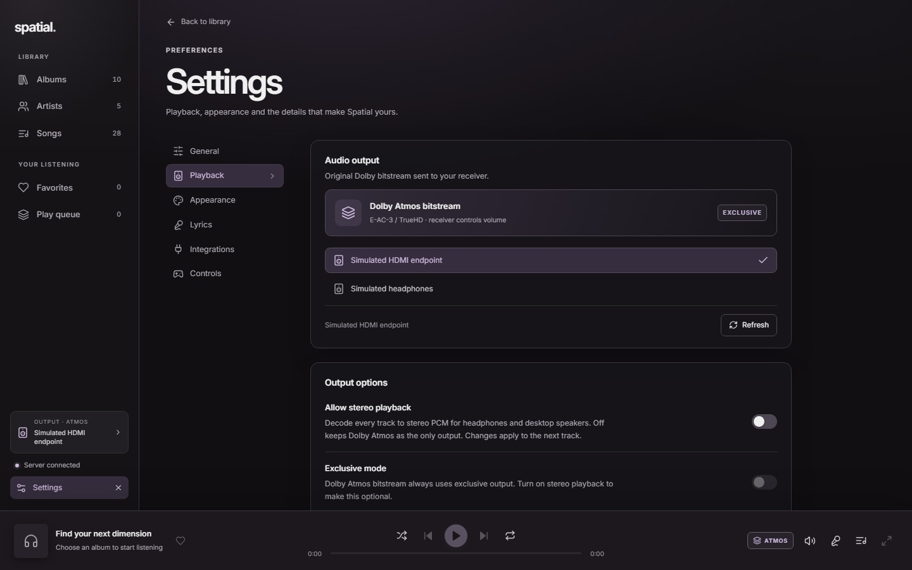
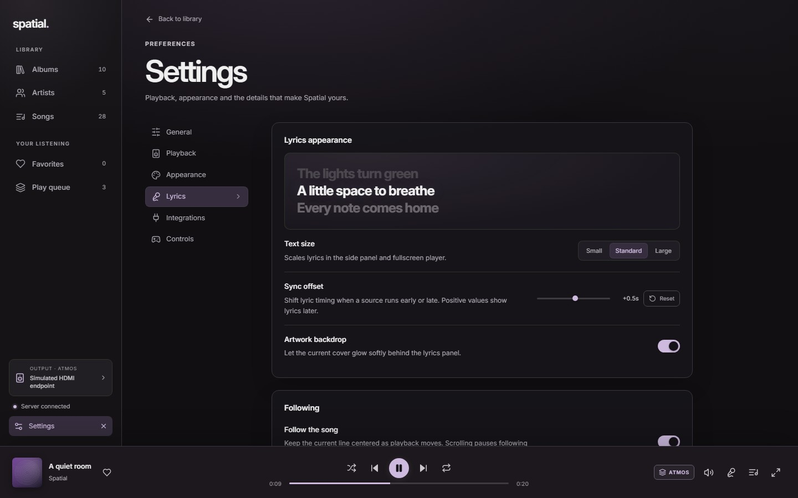

# Listening, artists and settings

[← Spatial](../README.md)

## A library organized by artist

The **Artists** view lists every artist credited in the collection, sorted A–Z. Opening an artist shows a portrait, their albums and any albums they appear on, with **Play** and **Shuffle** actions for the full discography.

Artist portraits are resolved on demand by the server. Spatial asks [Deezer](https://www.deezer.com/) for an exact name match, keeps only a square 600 px portrait and caches the result in `data/artwork/` and `data/library.sqlite`. No match, an offline server or an older server without the endpoint falls back to the artist's album artwork, so the interface never shows a broken image. Only the artist's name is sent to Deezer. Album covers use the existing iTunes/MusicBrainz fallback controlled by `remote_artwork`; see [server setup](server.md).

## Playback modes

**Dolby Atmos bitstream** is the default. Spatial passes the original E-AC-3 or TrueHD frames to the selected HDMI output and the receiver controls volume. Exclusive output is always used in this mode.

**Allow stereo playback** in **Settings → Playback** decodes tracks to stereo PCM instead. This is the mode for headphones and desktop speakers, and it supports the formats mpv can decode, including E-AC-3, TrueHD, AAC, FLAC, MP3 and WAV. The mode applies to the next track started after changing the setting.

- **Exclusive mode** requests exclusive control of the output device for the cleanest path. Turn it off to share audio with other applications; stereo playback then uses shared output.
- **Software volume** is available in stereo mode and is saved on this device. Dolby bitstream volume remains at full scale for the receiver.
- Selecting another output while playing stops playback first.

If a Dolby track fails on a stereo endpoint, turn on **Allow stereo playback** or select the receiver's HDMI output. Errors appear above the page and in the player.

## Settings

Settings is a full page reached from the bottom of the sidebar, with a tab for each area:

| Tab | Preferences |
| --- | --- |
| General | Library counts, server connection and change/disconnect, updates, reset preferences and credits |
| Playback | Audio output device, allow stereo playback, exclusive mode, software volume |
| Appearance | Artwork colors, reduce motion, layout density, track artwork, album order |
| Lyrics | Text size, sync offset, artwork backdrop, automatic following |
| Integrations | Discord activity, phone remote |
| Controls | Controller enablement and button mappings |

Preferences are stored in local app storage under `spatial-preferences:v1`; favorites remain per server. **Reset** in General restores the default playback, appearance and lyrics settings without touching favorites. Search moved to the sidebar and filters the current view; <kbd>Ctrl</kbd> + <kbd>K</kbd> (or <kbd>⌘</kbd> + <kbd>K</kbd>) focuses it.

## Lyrics

The side panel and fullscreen player share one reading experience: the active line is bright and scaled up, surrounding lines recede, and the current cover colors the background. Word timing from a local TTML sidecar or LRCLIB fills each word as it is sung. A sidecar is credited as **Local lyrics**; service results link to **LRCLIB**.

**Text size** scales both views. **Sync offset** shifts lyric timing by up to ±10 seconds in 0.1-second steps; positive values show lyrics later. **Artwork backdrop** controls the side panel's cover wash. **Follow the song** keeps the active line centered; scrolling the panel pauses following until **Follow song** is pressed or a line is clicked.

See the [lyrics guide](lyrics.md) for sidecar naming and timing support.
